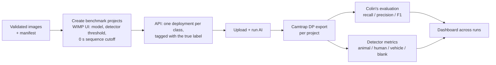

# WIMP model benchmark: automated classifier testing on the WildObs Image Management Platform

How well are the computer-vision (CV) models on the WildObs Image Management Platform (WIMP) performing? This repository automates the full benchmark: a set of human-validated camera-trap images goes in, and per-model evaluation reports and a comparison dashboard come out. The person running it does no programming.

It extends Colin Broughton's [model-benchmark-testing-workflow](https://github.com/WildObs/model-benchmark-testing-workflow), which scores Camtrap DP exports against known labels (recall, precision, F1 by confidence threshold). That repository is used unchanged, as a pinned git submodule in `vendor/`. This repository adds everything before and after Colin's evaluation step:

1. assembling a validated test set from existing WIMP projects,
2. creating the benchmark deployments and uploading the images through the WIMP API,
3. running the AI and collecting the Camtrap DP exports,
4. scoring MegaDetector separately from the species classifier (animal / human / vehicle / blank),
5. a dashboard comparing every model run in a test set.

Claude agent skills in `skills/` drive these steps, so a WildObs user (or the WildObs team on their behalf) can ask Claude to "benchmark these models on my images" instead of running code.

## What a user provides

| # | Input | Template |
|---|-------|----------|
| 1 | A folder of validated images, one subfolder per class (or images pulled from their WIMP projects) | `config/inputs_template/README.md` |
| 2 | WIMP metadata for the benchmark projects (names, environment, location, owner) | `config/inputs_template/benchmark_projects.csv` |
| 3 | A spreadsheet describing the validated images (file, class, source camera, source sequence) | `config/inputs_template/validated_images.csv` |
| 4 | The models to test (classifier, detector threshold, environment) | `config/inputs_template/models.yaml` |

About 1,000 images is enough for a first benchmark; around 250 per class gives tighter estimates.

## Pipeline



The WIMP API covers every step except project creation and project settings (AI model, detector confidence threshold, sequence cutoff), which are set once per project in the WIMP web interface. `docs/03_wimp_projects.Rmd` gives the exact settings.

## First test set: Australian Wet Tropics (AWT), November 2026

The validated images come from Skye Anderson's AWT camera-trap projects (UQ), which are fully human-sorted on WIMP. Five model runs (all projects: sequence cut-off 0 s, AI sharing Private so the test images never enter model training):

| Run | Environment | Classifier | MegaDetector threshold |
|-----|-------------|------------|------------------------|
| `prod_awt_default` | PROD | Wet Tropics | production default |
| `test_awt_md025` | TEST | Wet Tropics | 0.25 |
| `test_awt_md050` | TEST | Wet Tropics | 0.50 |
| `test_awt_md075` | TEST | Wet Tropics | 0.75 |
| `prod_md_v6` | PROD | none (MegaDetector V6 only) | production default |

The detector confidence threshold became a project setting on TEST on 27 October 2026 (QCIF pipeline changes by Renuka Sharma).

### Results (3 Nov 2026; 4,399 images, 19 classes)

| Run | Animal recall | Blank recall | Human precision | No AI result | Median species F1* |
|-----|--------------:|-------------:|----------------:|-------------:|-------------------:|
| PROD, Wet Tropics, MD default | 0.77 | 0.34 | 0.34 | 6.5% | 0.65 |
| TEST, Wet Tropics, MD 0.25 | 0.92 | 0.09 | 0.80 | 0.0% | 0.54 |
| TEST, Wet Tropics, MD 0.50 | 0.82 | 0.50 | 0.82 | 0.1% | 0.65 |
| TEST, Wet Tropics, MD 0.75 | 0.68 | 0.79 | 0.83 | 0.0% | 0.64 |
| PROD, MegaDetector V6 only | 0.00 | 0.34 | 0.84 | 84.6% | n/a |

*Median F1 at each run's best confidence threshold over the 14 animal classes the model has. Findings and caveats: [`results/awt_2026_11/README.md`](results/awt_2026_11/README.md); all numbers: `results/awt_2026_11/dashboard.html`.

## Repository layout

```
config/            run specifications (one YAML per test set) and input templates
wimpbench/         Python package: WIMP API client, image selection, upload, export, detector metrics, dashboard
vendor/            Colin's model-benchmark-testing-workflow (git submodule, unchanged)
docs/              step-by-step documentation as R Markdown (python chunks; converts to Jupyter)
skills/            Claude agent skills that run the workflow
results/           reports and dashboard per test set (no images)
Input_Data/        Camtrap DP exports (not tracked)
```

## Running it

With Claude: open this repository in Claude Code and ask "run the WIMP model benchmark for config/awt_2026_11.yaml". `CLAUDE.md` tells Claude what to do.

By hand:

```bash
git clone --recurse-submodules https://github.com/EcologicalCascadesLab/wimp-model-benchmark.git
cd wimp-model-benchmark
pip install -r requirements.txt
export WIMP_PROD_KEY=pk_...   # WIMP > User settings > API keys
export WIMP_TEST_KEY=pk_...
python -m wimpbench check   --config config/awt_2026_11.yaml
python -m wimpbench select  --config config/awt_2026_11.yaml   # build the validated-image manifest
python -m wimpbench fetch   --config config/awt_2026_11.yaml   # download the test images
python -m wimpbench upload  --config config/awt_2026_11.yaml   # deployments + upload + AI
python -m wimpbench status  --config config/awt_2026_11.yaml
python -m wimpbench export  --config config/awt_2026_11.yaml   # Camtrap DP into Input_Data/
python -m wimpbench evaluate --config config/awt_2026_11.yaml  # Colin's reports + detector metrics + dashboard
```

API keys are read from environment variables only and are never written to this repository.

## Credits

Benchmark evaluation method and code: Colin Broughton (Bush Heritage Australia / WildObs). WIMP AI pipeline: QCIF (Renuka Sharma, Daraka Hewa Vithanage, Muhammad Yasir). Validated AWT images: Skye Anderson (UQ). Workflow automation: Matthew Luskin (UQ / WildObs) with Claude.

## Licence

Apache License 2.0, matching the upstream workflow.
